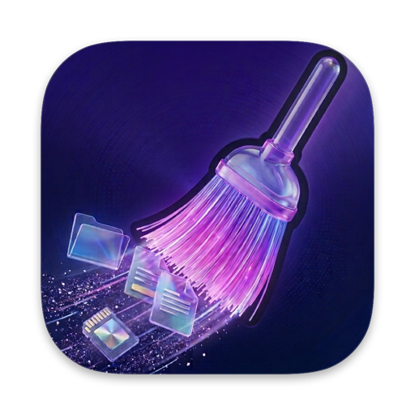

  

<h1 align="center">Swept</h1>

  <b>A calm, honest disk cleaner for your Mac.</b> 
  Finds the caches, logs and leftovers hiding in forgotten corners, explains each one, 
  and only cleans what you choose.

  
  
  
  
  

  

  Version 1.0 · macOS 26 Tahoe or later · Apple silicon &amp; Intel · Free and open source · <a href="https://github.com/rebekkaorth/Swept/releases/latest">Release notes</a>

---

## Requirements

| | |
|---|---|
| **macOS** | 26 Tahoe or later |
| **Mac** | Apple silicon or Intel |
| **Permission** | Full Disk Access (Swept shows you how to turn it on) |
| **Internet** | Not needed. Swept never goes online. |

## Install

1. [Download the latest version](https://github.com/rebekkaorth/Swept/releases/latest/download/Swept.dmg) (`Swept.dmg`).
2. Open the `.dmg` and drag **Swept** into **Applications**.
3. Open Swept from Applications and press **Scan My Mac**.
4. When asked, give Swept **Full Disk Access** in System Settings ▸ Privacy & Security.
   macOS needs this before any app can see other apps' caches.
5. After the first scan, choose your reminders and whether Swept should open at login.

Swept is signed with a Developer ID and notarized by Apple, so it opens without warnings.

## What Swept looks at

Xcode & Simulators · App Caches · Leftovers from deleted apps · Developer Tool Caches ·
Application Support · Logs · Saved App State · Trash · iOS Backups · Mail Attachments ·
Time Machine Snapshots · Downloads

## Reminders and the menu bar

- **Menu bar icon:** see at a glance how much you could reclaim. You can hide it in Settings.
- **Reminders:** set a limit, then pick how often (daily, every 3 days or weekly) and at what
  time. While you're over your limit, Swept sends one calm notification. Snooze it for a week
  any time.
- **Open at login:** Swept can start quietly when you log in, so it keeps watching after a
  restart. You can turn this on or off in Settings, or in System Settings ▸ General ▸ Login
  Items & Extensions.

## What Swept never does

- **No network.** Swept makes no network connections, has no analytics and no third-party code.
- **Trash first.** Cleaned items go to the Trash, so you can put them back. Only emptying the
  Trash and deleting Time Machine snapshots are permanent, and Swept asks before doing either.
- **Allowlist only.** Swept only touches folders on a fixed allowlist
  ([`ScanSources.swift`](Swept/Engine/ScanSources.swift)). Places like Mail, Messages, Photos,
  Keychains and iCloud Drive can be shown, but never deleted.
- **Nothing pre-checked that you might miss.** "Select all" only picks items that are safe to remove.

## Why Full Disk Access?

macOS hides other apps' data from every app unless you grant Full Disk Access. Swept uses it
only to read sizes and to move the items you choose to the Trash. You can revoke it any time
in System Settings ▸ Privacy & Security ▸ Full Disk Access.

## Uninstall

1. If Swept opens at login, switch off **Open at login** in Swept's Settings (⌘,).
2. Quit Swept (menu bar icon ▸ Quit), then drag it from Applications to the Trash.
3. Optional: delete its settings in `~/Library/Preferences/com.rebekkaorth.Swept.plist`.

## Build from source

1. Install Xcode 26 or later.
2. Clone the repo and open `Swept.xcodeproj`.
3. Run (⌘R). Run the tests with ⌘U.

A fresh clone builds and runs on your own Mac without an Apple Developer account. To sign with
your own team, copy `Config/Local.xcconfig.example` to `Config/Local.xcconfig` and enter your
Team ID (that file is git-ignored). How the official download is made (signing, notarization,
DMG) is described in [BUILD.md](BUILD.md).

## Reporting problems

Found a bug, or have an idea? Please [open an issue](https://github.com/rebekkaorth/Swept/issues/new)
and describe what happened, together with your macOS version and Swept version
(Swept ▸ About Swept). This includes Swept deleting, or offering to delete, something it
shouldn't.

If you found a way another app or person could misuse Swept, for example to delete files
outside its allowed folders, please don't post it publicly. Use
[Report a vulnerability](https://github.com/rebekkaorth/Swept/security/advisories/new) instead,
so it can be fixed before others learn about it.

## Privacy

Everything Swept does happens on your Mac.

- **No data leaves your Mac.** Swept makes no network connections: no servers, no account,
  no analytics, no crash reports, no update checks.
- **Nothing is collected.** I don't receive any information about you, your Mac or your files.
- **Your settings stay local.** Your limit, reminder time and last scan results are saved only
  in `~/Library/Preferences/com.rebekkaorth.Swept.plist` on your Mac.
- **Full Disk Access is used only on your Mac,** to measure folders and to move the items you
  choose to the Trash.

Downloading Swept from GitHub is covered by
[GitHub's privacy statement](https://docs.github.com/site-policy/privacy-policies/github-general-privacy-statement).

## Use at your own risk

Swept is free, open-source software provided "as is", without warranty of any kind (see the
[license](LICENSE)). It only touches known cache and leftover folders and moves items to the
Trash first, but please review what you clean. You're responsible for the files on your Mac.

## License

[MIT](LICENSE) © 2026 rebekkaorth
